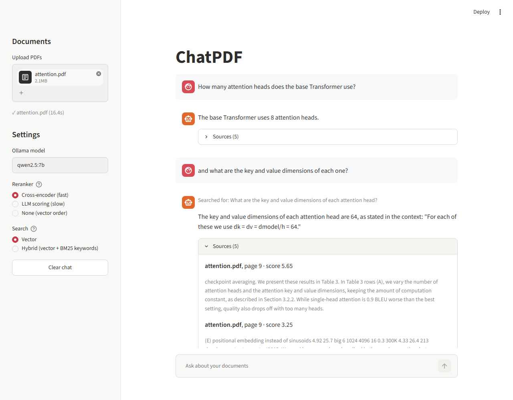
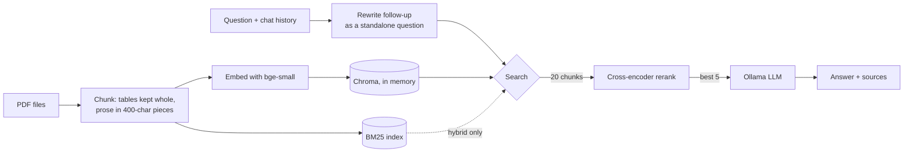

# ChatPDF: local Q&A over your PDFs

[](https://github.com/sathvik8317/ChatPDF-AI-Powered-Document-Q-A-System/actions/workflows/tests.yml)

Upload PDFs, ask questions, get answers with the file and page they came from. Everything runs on your machine: a local LLM through [Ollama](https://ollama.com), FastEmbed for embeddings and reranking, and Chroma as an in-memory vector store.



## Features

- **Multiple PDFs** in one session, searched together.
- **Table-aware chunking**: tables stay in one chunk with their caption and column headers, so a row like `Transformer (base model) 27.3` can still be found and read.
- **Citations**: every answer has a "Sources" dropdown with the file name, page number and the text it used.
- **Follow-up questions**: "and what about the decoder?" is rewritten into a full question using the last 3 exchanges before searching.
- **Grounded answers**: the model answers only from the retrieved text and says *"I couldn't find that in the document"* otherwise.
- **Reranking**: a cross-encoder re-orders the retrieved chunks before they reach the model (an LLM-based reranker is kept for comparison).
- **Hybrid search** (optional): vector search plus BM25 keyword search, merged with reciprocal rank fusion.
- **Streaming** answers in a Streamlit chat UI.

## How it works



1. **Ingest**: `PyPDFLoader` reads each page. Tables (runs of number-heavy lines) are pulled out first and kept whole, each chunk starting with the table's caption and column headers. The remaining prose goes through `RecursiveCharacterTextSplitter` (400 characters, 200 overlap). Every chunk is tagged with its file name and page.
2. **Rewrite**: if there is chat history, the LLM turns the follow-up into a standalone question.
3. **Search**: the 20 most similar chunks by embedding. In hybrid mode, BM25 keyword results are fused in with reciprocal rank fusion.
4. **Rerank**: `ms-marco-MiniLM-L-6-v2` scores each (question, chunk) pair; the best 5 become the context.
5. **Answer**: the LLM answers from that context only, streamed to the UI with the 5 sources.

## Evaluation

`eval/run_eval.py` downloads *Attention Is All You Need* and asks 23 questions with known answers ([`eval/questions.json`](eval/questions.json)): 21 facts from the paper (layer counts, BLEU scores, training setup) and 2 that are not in it, where the right reply is "couldn't find it". One of those asks for GPT-3's parameter count, which the model knows from training, to check it doesn't answer from memory.

- **Retrieval hit rate**: a retrieved source is on the page that holds the answer.
- **Answer accuracy**: the answer contains the expected value (whole-word match, so "4" doesn't match "24").
- **Seconds / question**: end to end on a Windows PC, with `qwen2.5:7b` in Ollama.

| Search | Reranker | Retrieval hit rate | Answer accuracy | Seconds / question |
|---|---|---|---|---|
| vector | **cross-encoder** (default) | 100% | **100%** | 4.9 |
| vector | LLM scoring | 100% | 96% | 16.7 |
| vector | none | 100% | 100% | 3.9 |
| hybrid | cross-encoder | 100% | 100% | 4.7 |
| hybrid | LLM scoring | 100% | 100% | 12.9 |
| hybrid | none | 100% | 96% | 3.9 |

Before table-aware chunking, the same run looked like this:

| Search | Reranker | Answer accuracy | Seconds / question |
|---|---|---|---|
| vector | cross-encoder | 96% | 4.7 |
| vector | LLM scoring | 83% | 16.7 |
| vector | none | 91% | 3.2 |
| hybrid | cross-encoder | 96% | 4.6 |
| hybrid | LLM scoring | 87% | 12.9 |
| hybrid | none | 96% | 3.5 |

What this shows:

- **Chunking mattered more than search or reranking.** One question failed in every configuration: the base model's BLEU score (27.3) in Table 2. The row text was extracted fine, but the 400-character splitter cut it away from the caption and column headers ("Table 2 … BLEU … EN-DE"), so the chunk ranked 12th and never reached the model. Keeping tables whole with their header moved it to 2nd and fixed it everywhere. It also fixed a Table 4 question under LLM reranking.
- **The cross-encoder is the default because it's fast and never worse.** LLM scoring (what the original app did: the LLM rates all 20 chunks one by one) is 2.7–3.4x slower and no more accurate.
- **Hybrid search** helped the setups without a good reranker before the chunking fix. After it, the differences are one question either way, so vector search stays the default and hybrid is a sidebar option.
- **23 questions is small**: one question is about 4 percentage points, and with most configurations at 100% the set is now too easy to separate them. A bigger, harder set is the next thing to add.
- **Known limit**: tables are detected as runs of number-heavy lines, so a table of formulas (Table 1 here: `O(n² · d)`) is not detected and is chunked like prose.

Run it yourself (Ollama must be running):

```bash
python eval/run_eval.py                                    # all 6 configurations
python eval/run_eval.py --search hybrid --rerankers none   # just one
```

Results go to `eval/results.md` and, with every answer, `eval/results.json`.

## Getting started

Requires Python 3.11+ and [Ollama](https://ollama.com).

```bash
git clone https://github.com/sathvik8317/ChatPDF-AI-Powered-Document-Q-A-System.git
cd ChatPDF-AI-Powered-Document-Q-A-System

python -m venv .venv
source .venv/bin/activate        # Windows: .venv\Scripts\activate
pip install -r requirements.txt

ollama pull qwen2.5:7b
streamlit run app.py
```

Open http://localhost:8501, upload PDFs in the sidebar and start asking. The embedding and reranker models (about 150 MB) download on first use.

## Configuration

| Setting | Where | Default |
|---|---|---|
| LLM | `LLM_MODEL` env var, or the sidebar | `qwen2.5:7b` |
| Embedding model | `EMBEDDING_MODEL` env var (any FastEmbed text model) | `BAAI/bge-small-en-v1.5` |
| Reranker | sidebar | cross-encoder |
| Search | sidebar | vector |
| Chunks retrieved / sent to the LLM | `RETRIEVE_K` / `TOP_N` in `rag.py` | 20 / 5 |

## Project structure

```
├── app.py              # Streamlit chat UI
├── rag.py              # ingest, search, rerank, rewrite, answer
├── eval/
│   ├── questions.json  # 23 questions on "Attention Is All You Need"
│   ├── run_eval.py     # runs every search x reranker configuration
│   └── results.md      # latest results
├── tests/              # pytest, uses a fake LLM so Ollama isn't needed
└── requirements.txt
```

## Tests

```bash
pip install -r requirements-dev.txt
pytest
```

The tests swap Ollama for a scripted fake model and build tiny PDFs on the fly, so they run anywhere, including GitHub Actions on every push.

## License

MIT. See [LICENSE](LICENSE).
